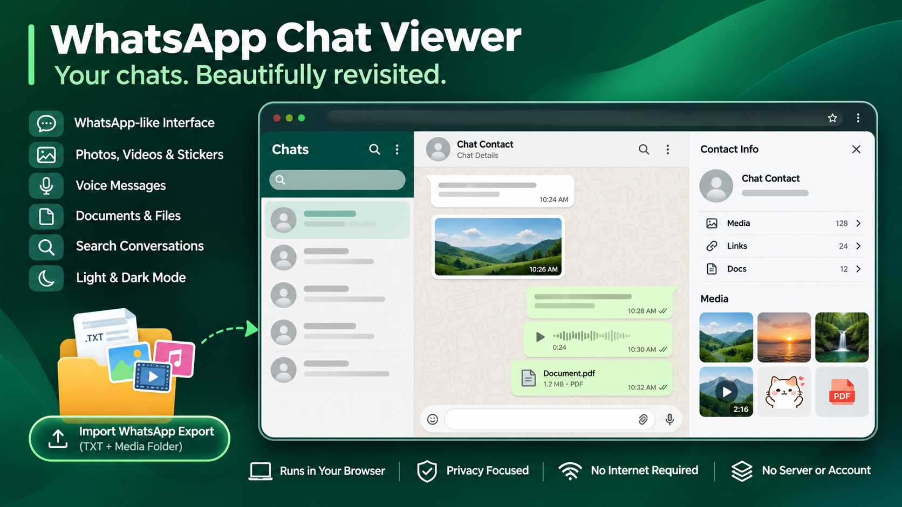
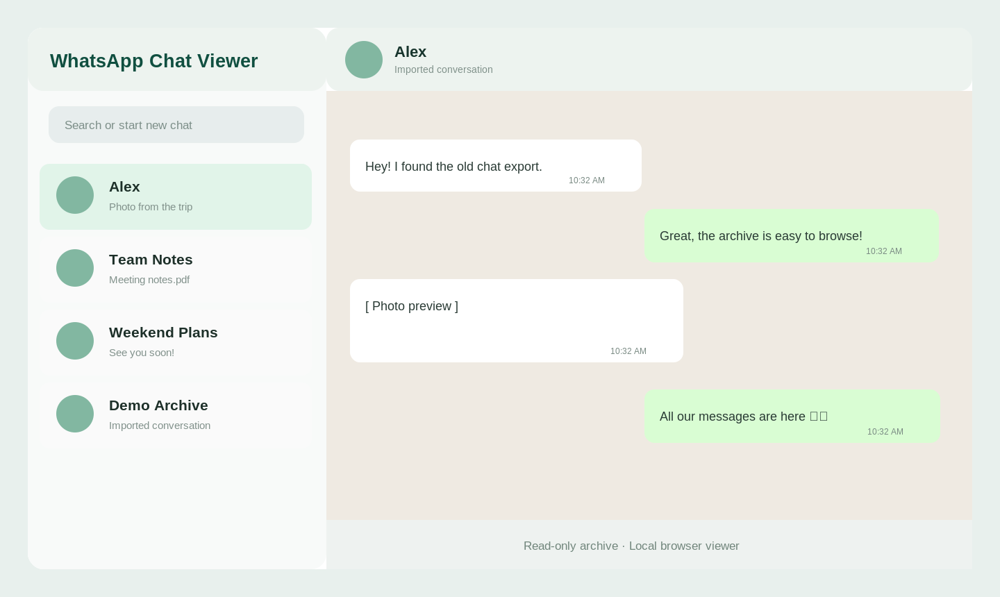
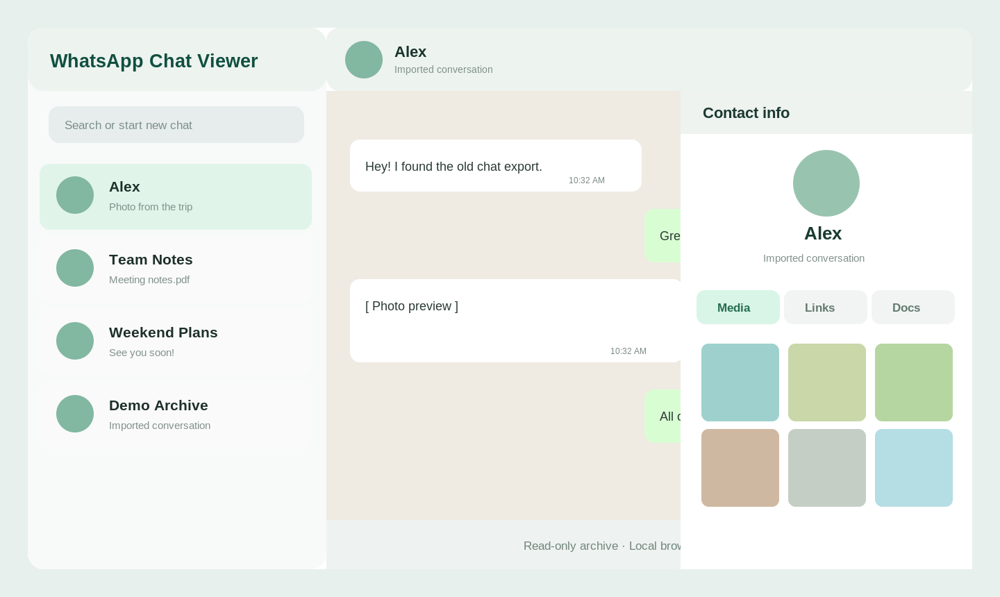
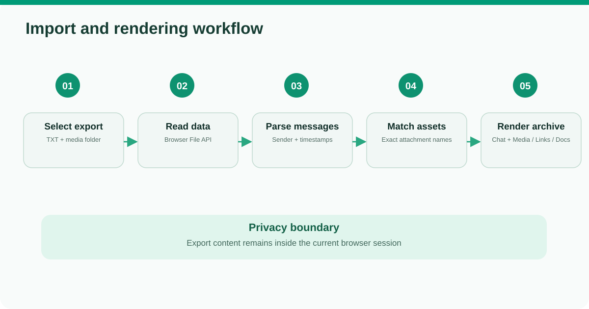
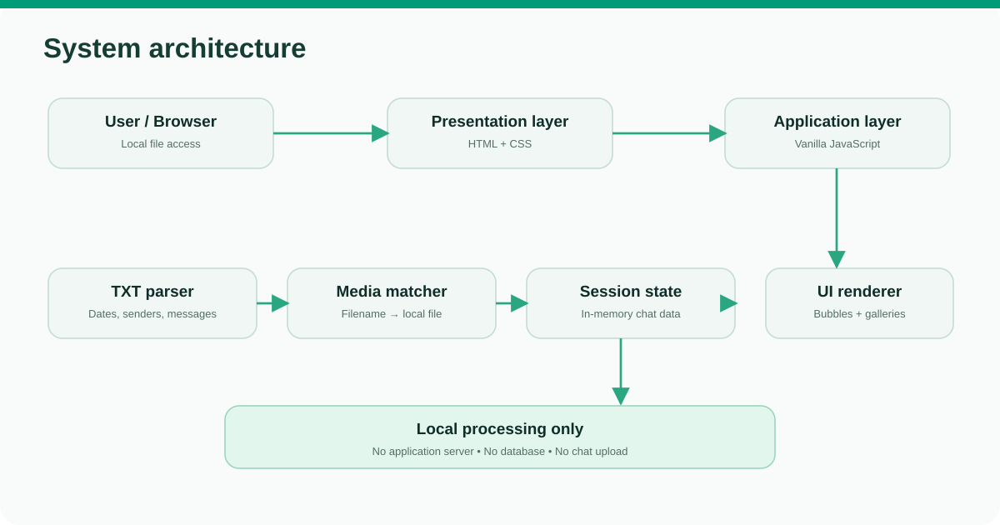

<div align="center">



# WhatsApp Chat Viewer

**A private, browser-based viewer for exported WhatsApp chats and their media.**

    

**[Overview](#overview) · [Features](#features) · [Product screenshots](#product-screenshots) · [Architecture](#architecture) · [Getting started](#getting-started) · [Specifications](#product-specifications) · [Limitations](#limitations)**

</div>

> [!IMPORTANT]
> An independent, **read-only** archive viewer—not WhatsApp, an official WhatsApp client, or a way to restore chats into WhatsApp. Not affiliated with Meta or WhatsApp.

## Overview

WhatsApp chat exports preserve messages in a `.txt` file and can include separate attachments. This project brings those files into a familiar two-column conversation interface, with local media previews and a contact-information panel for **Media, Links and Docs**.

**The problem:** text exports are difficult to browse and attachments are separated from their messages. **The solution:** import the TXT or complete export folder and reconstruct an interactive chat archive in the browser.

## Product screenshots

The following **illustrative interface mockups** use fictional demo data. They are visual previews, not screenshots captured from the running app.



<details>
<summary>Additional product views</summary>

**Contact information and attachment browser**



</details>

> **Before publishing:** replace these mockups with genuine screenshots from your own latest build for an accurate product demonstration.

## Features

| Capability | Description |
|---|---|
| **Import full export folders** | Select a folder containing a WhatsApp TXT export and available attachments. |
| **Import TXT alone** | Browse conversation text even when attachments are unavailable. |
| **Correct message direction** | Choose your sender name; your messages appear on the right. |
| **Rich attachments** | Match exported filenames with photos, stickers, videos, voice notes, and files. |
| **Media, Links & Docs** | Open the chat header to browse the contact information and shared content. |
| **Message search** | Search within the selected conversation. |
| **Multiple chats** | Import more than one conversation during the browser session. |
| **Light / dark mode** | Switch between two viewing themes. |
| **Local-first processing** | Chat content is processed in your browser; no app backend is needed. |

## How it works



1. **Choose an export** — select a `.txt` file or a full folder with attachments.
2. **Parse messages** — extract senders, timestamps, message text and references to attachments.
3. **Match media** — find local attachment files by their filenames in the TXT export.
4. **Identify yourself** — select which sender should have right-aligned message bubbles.
5. **Explore the archive** — browse messages, search, and open Media, Links and Docs.

## Architecture



The website is a **static front-end application**:

- **Presentation:** `index.html` defines the layout and dialogs; `style.css` handles responsive appearance and themes.
- **Processing:** `script.js` parses common Android/iOS TXT formats, links media, and renders the conversation and info panels.
- **Storage:** parsed conversations and selected media references live in browser memory for the current session. Reimport after refresh.
- **Privacy boundary:** no application server, database, or cloud account is required. External links opened by users may contact their respective sites.

## Getting started

**Requirements:** a modern browser (Chrome or Edge recommended), JavaScript enabled, and an exported WhatsApp chat.

```bash
git clone https://github.com/YOUR_USERNAME/YOUR_REPOSITORY.git
cd YOUR_REPOSITORY
```

Open **`index.html`** in your browser. No `npm install`, backend server, or build command is required.

**Import the export:**

1. In WhatsApp, export a conversation **with media** if you want attachment previews.
2. Extract the export archive into a directory.
3. In the viewer, click **Import WhatsApp export folder** and choose that directory.
4. Select your own name from the list of detected participants.
5. Read the conversation; click the contact name for **Media, Links and Docs**.

Example directory:

```text
WhatsApp Chat/
├── _chat.txt
├── IMG-20231029-WA0001.jpg
├── VID-20231029-WA0002.mp4
├── STK-20231029-WA0040.webp
├── PTT-20231029-WA0003.opus
└── DOC-20231029-WA0004.pdf
```

The parser supports common lines such as:

```text
29/10/2023, 10:30 - Alex: Hi!
29/10/2023, 10:31 - You: Hello!
29/10/2023, 10:32 - Alex: IMG-20231029-WA0001.jpg (file attached)
```

## Product specifications

| Attribute | Specification |
|---|---|
| Category | Read-only conversation archive viewer |
| Platform | Modern desktop and mobile web browsers |
| Stack | HTML5, CSS3, vanilla JavaScript |
| Backend / database | None |
| Input | Exported `.txt` chats; optional folder of media files |
| Output | Searchable WhatsApp-inspired message interface |
| Data persistence | Current browser session only |
| Network requirement | Not required for core operation |
| Deployment | Local files or static website hosting |

### Supported attachments

| Type | Formats / behavior |
|---|---|
| Images / stickers | JPG, PNG, GIF, WEBP and other recognized image extensions; browser rendering varies |
| Video | MP4, WEBM, MOV and other recognized video extensions; playback requires browser codec support |
| Audio / voice | MP3, OGG, OPUS, M4A, WAV and other recognized audio extensions; playback requires browser support |
| Documents | PDF, DOC/DOCX, XLS/XLSX, PPT/PPTX, TXT and other recognized file types; open/download if supported |

### Functional requirements

| ID | Requirement | Status |
|---|---|---|
| FR-01 | Import TXT and complete export folders | Implemented |
| FR-02 | Parse senders, message text and timestamps | Implemented for common export formats |
| FR-03 | Select sender for incoming/outgoing alignment | Implemented |
| FR-04 | Match available media files to messages | Implemented with filename matching |
| FR-05 | Media, Links and Docs navigation | Implemented |
| FR-06 | Search and theme switching | Implemented |
| FR-07 | Persistent archive across refresh | Not implemented |
| FR-08 | Restore history to official WhatsApp | Not supported |

## Project structure

```text
whatsapp-chat-viewer/
├── index.html
├── style.css
├── script.js
├── README.md
└── assets/
    ├── hero-banner.png
    ├── chat-interface.png
    ├── contact-media.png
    ├── system-architecture.svg
    └── import-flow.svg
```

## Limitations

- **Not an exact clone:** layout is WhatsApp-inspired; not every official interaction is reproduced.
- **No real messaging:** you cannot send messages or connect to a WhatsApp account.
- **No data restoration:** TXT exports cannot be imported into the official app via this viewer.
- **Missing media:** attachments excluded from the export cannot be recovered.
- **Incomplete metadata:** profile images, verified delivery/read receipts and other original app metadata are unavailable unless supplied in another format.
- **Format variations:** region, OS, app version and export format can affect successful parsing.
- **Session-only:** refreshing the page clears imported data; select the files again.
- **Large exports:** very large archives can increase browser memory usage and processing time.

## Privacy & security

The app handles selected local files with browser APIs. It does not require a backend or an account. **Keep exported chats private**, avoid committing real conversations or personal media to public repositories, and review any third-party scripts before adding them.

## Roadmap

- [ ] Remember imported archives with IndexedDB (opt-in)
- [ ] User-supplied profile photos
- [ ] Jump to date and advanced search filters
- [ ] Improved voice message presentation
- [ ] Accessibility and export-format compatibility improvements
- [ ] Portable offline PWA packaging

## Contributing

Issues and pull requests are welcome. Test changes with synthetic/demo exports whenever possible, and avoid publishing personal conversation data.

## License

**No license is specified by this README.** Add a `LICENSE` file if you want to grant explicit reuse and distribution rights.

---

<div align="center"><sub>WhatsApp Chat Viewer · An independent archival tool · WhatsApp is a trademark of its respective owner.</sub></div>
